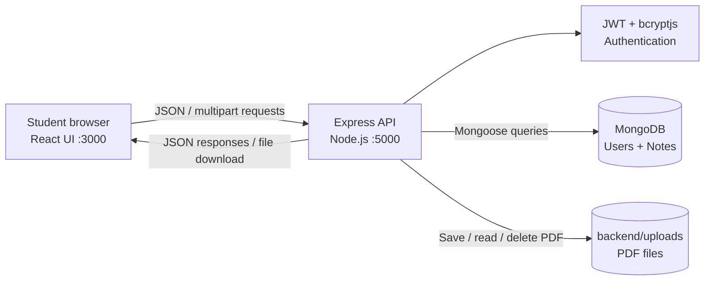
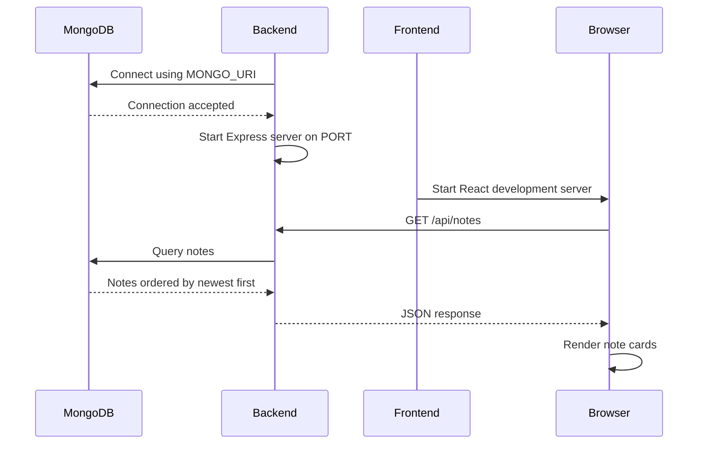
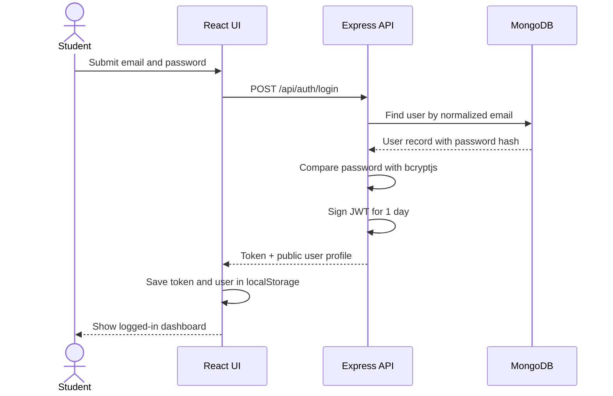
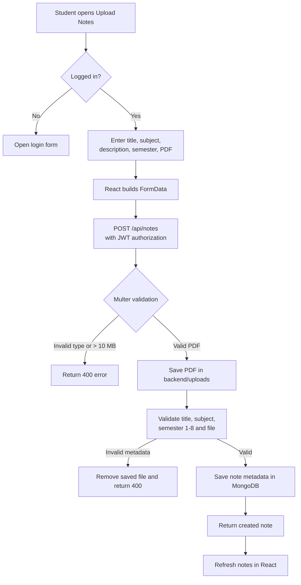
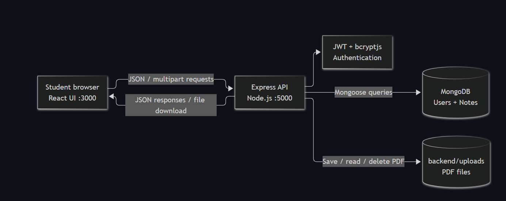

# NoteNest

> **Find. Share. Learn.** — a student-to-student platform for discovering and sharing study notes.

NoteNest is a full-stack JavaScript application where students can register, log in, browse study material, search notes, filter by semester, upload PDF notes, download shared files, and delete notes they own.

<p align="center">
  <strong>React frontend</strong>
  &nbsp;•&nbsp;
  <strong>Express API</strong>
  &nbsp;•&nbsp;
  <strong>MongoDB database</strong>
</p>

---

## Contents

- [What the application does](#what-the-application-does)
- [How the application works](#how-the-application-works)
- [Architecture](#architecture)
- [Project structure](#project-structure)
- [Features](#features)
- [Tech stack](#tech-stack)
- [Prerequisites](#prerequisites)
- [Run locally](#run-locally)
- [User flows](#user-flows)
- [API reference](#api-reference)
- [Data model](#data-model)
- [Frontend state and storage](#frontend-state-and-storage)
- [Troubleshooting](#troubleshooting)
- [Production readiness](#production-readiness)
- [License](#license)

## What the application does

| User | Action | Result |
| --- | --- | --- |
| Visitor | Opens the app | Sees the NoteNest landing page and public notes |
| Visitor | Searches or selects a semester | The note cards are filtered in the browser |
| Visitor | Downloads a note | The backend returns the stored PDF |
| New student | Registers | A user account is created with a hashed password |
| Student | Logs in | The API returns a one-day JWT and public profile |
| Logged-in student | Uploads a PDF | The file is stored locally and its metadata is saved in MongoDB |
| Note owner | Deletes a note | The PDF and its MongoDB record are removed |

## How the application works

### High-level architecture



### Application startup

The backend must be started before the frontend can load notes.



### Authentication flow



The token is sent on protected requests in the `Authorization` header:

```http
Authorization: [JWT token]
```

The backend middleware verifies the token before allowing uploads, deletions, or `/api/auth/me`.

### Note upload flow



### Download and delete flows

**Download:** the browser requests `/api/notes/:id/download`; the API validates the MongoDB ID, checks that the stored path stays inside `backend/uploads`, verifies the file exists, and sends the PDF.

**Delete:** the API validates the ID, loads the note, compares `uploadedBy` with the authenticated user ID, deletes the local PDF, and then deletes the MongoDB document. A student cannot delete another student's note.

## Architecture

### Frontend responsibilities

- Renders the single-page NoteNest interface.
- Loads public notes when the app starts.
- Handles registration, login, logout, upload, download, and delete actions.
- Stores the JWT and public user profile in browser `localStorage`.
- Filters loaded notes by title, subject, and semester.
- Displays loading, success, empty, and error states.

Main frontend files:

| File | Responsibility |
| --- | --- |
| `frntend/frontend/src/App.js` | Main UI, state, API calls, and user flows |
| `frntend/frontend/src/App.css` | NoteNest layout, responsive styles, cards, forms, and buttons |
| `frntend/frontend/src/index.js` | React application entry point |
| `frntend/frontend/public/index.html` | HTML shell used by Create React App |

### Backend responsibilities

- Loads environment variables and starts the server.
- Connects to MongoDB before accepting requests.
- Enables CORS and JSON request parsing.
- Routes authentication and note requests.
- Validates JWTs for protected actions.
- Validates and stores PDF uploads.
- Enforces note ownership during deletion.

Main backend files:

| File | Responsibility |
| --- | --- |
| `backend/server.js` | Express setup, route registration, health check, and startup |
| `backend/config/db.js` | Mongoose connection |
| `backend/routes/authRoutes.js` | Registration and login |
| `backend/routes/noteRoutes.js` | Upload, list, download, and delete operations |
| `backend/middleware/authMiddleware.js` | Bearer-token verification |
| `backend/models/users.js` | User schema |
| `backend/models/note.js` | Note schema |
| `backend/uploads/` | Local PDF storage |

## Project structure

```text
vsec project/
├── README.md
├── backend/
│   ├── config/
│   │   └── db.js
│   ├── middleware/
│   │   └── authMiddleware.js
│   ├── models/
│   │   ├── note.js
│   │   └── users.js
│   ├── routes/
│   │   ├── authRoutes.js
│   │   └── noteRoutes.js
│   ├── uploads/              # Runtime PDF files; not application source
│   ├── .env                  # Local secrets and connection settings
│   ├── package.json
│   └── server.js
└── frntend/
    └── frontend/
        ├── public/
        ├── src/
        │   ├── App.css
        │   ├── App.js
        │   ├── index.css
        │   └── index.js
        ├── package.json
        └── README.md
```

> `frntend/frontend` is the existing directory name. It is intentionally preserved so the documented commands match the repository.

## Features

- Student registration with name, email, and six-character minimum password
- Email normalization and duplicate-email protection
- Password hashing with `bcryptjs`
- JWT login tokens with a one-day expiry
- Public note browsing
- Search by note title or subject
- Semester filtering for semesters 1 through 8
- PDF-only uploads
- Maximum upload size of 10 MB
- Note metadata stored in MongoDB
- PDF files stored in `backend/uploads`
- Download endpoint with path-traversal protection
- Owner-only note deletion
- Responsive student-focused interface
- Backend health check at `/api/health`

## Tech stack

| Layer | Technology |
| --- | --- |
| UI | React 19 |
| Frontend tooling | Create React App / `react-scripts` |
| API | Node.js + Express 5 |
| Persistence | MongoDB + Mongoose |
| Authentication | JWT + bcryptjs |
| File uploads | Multer |
| Styling | CSS |

## Prerequisites

Install:

- Node.js 18 or newer
- npm
- MongoDB Community Server, or a MongoDB Atlas database

Check Node.js and npm:

```bash
node --version
npm --version
```

## Run locally

### 1. Start MongoDB

Start MongoDB locally, or prepare an Atlas connection string. The default local database is:

```text
mongodb://127.0.0.1:27017/NoteNest
```

### 2. Configure backend environment variables

Create `backend/.env`:

```env
PORT=5000
MONGO_URI=mongodb://127.0.0.1:27017/NoteNest
JWT_SECRET=replace-with-a-long-random-secret
```

Use a long random `JWT_SECRET`. Do not commit real secrets.

### 3. Install and run the backend

From the project root:

```bash
cd backend
npm install
npm run dev
```

The backend runs at `http://localhost:5000`.

Use `npm start` for a normal Node.js process without nodemon.

### 4. Install and run the frontend

Open a second terminal:

```bash
cd frntend/frontend
npm install
npm start
```

The frontend runs at `http://localhost:3000` and calls `http://localhost:5000/api`.

### 5. Verify the backend

Open or request:

```text
http://localhost:5000/api/health
```

Expected response:

```json
{
  "success": true,
  "message": "NoteNest backend is running"
}
```

## User flows

### Register and log in

1. Select **Sign Up**.
2. Enter name, email, and a password of at least six characters.
3. The backend validates the values, normalizes the email, checks for duplicates, hashes the password, and creates the user.
4. Log in with the same email and password.
5. The frontend stores the JWT and user profile in `localStorage`.

### Find a note

1. Enter a title or subject in the search box.
2. Select a subject shortcut, or choose a semester from the dropdown.
3. React filters the notes already loaded from the API.
4. Select **Download** to open the PDF download endpoint.

The backend also supports server-side query parameters:

```text
GET /api/notes?subject=DBMS&semester=3
```

### Upload a note

1. Log in.
2. Select **Upload Notes**.
3. Enter the title, subject, optional description, and semester.
4. Choose a PDF file.
5. Submit the form.
6. The backend validates the JWT, file type, file size, required fields, and semester.
7. The PDF is saved to `backend/uploads`.
8. The note record is saved to MongoDB with the authenticated user as `uploadedBy`.
9. The frontend refreshes the note list.

### Delete an uploaded note

1. Log in as the note owner.
2. Select **Delete** on one of your own notes.
3. Confirm the browser prompt.
4. The backend checks ownership before deleting both the file and database record.

## API reference

Base URL: `http://localhost:5000/api`

### Health

| Method | Endpoint | Auth | Description |
| --- | --- | --- | --- |
| `GET` | `/health` | No | Confirms that the API process is running |

### Authentication

| Method | Endpoint | Auth | Body |
| --- | --- | --- | --- |
| `POST` | `/auth/register` | No | `{ "name": "...", "email": "...", "password": "..." }` |
| `POST` | `/auth/login` | No | `{ "email": "...", "password": "..." }` |
| `GET` | `/auth/me` | JWT required | None |

### Notes

| Method | Endpoint | Auth | Description |
| --- | --- | --- | --- |
| `GET` | `/notes` | No | Lists notes, newest first |
| `POST` | `/notes` | JWT required | Creates a note and uploads a PDF |
| `GET` | `/notes/:id/download` | No | Downloads a note PDF |
| `DELETE` | `/notes/:id` | JWT required | Deletes an owned note and its PDF |

#### List filters

```text
GET /api/notes?subject=operating%20system&semester=4
```

- `subject` is case-insensitive.
- `semester` must be an integer from `1` to `8`.

#### Upload fields

The `POST /notes` request uses `multipart/form-data`:

| Field | Type | Required | Rules |
| --- | --- | --- | --- |
| `title` | Text | Yes | Note title |
| `description` | Text | No | Optional description |
| `subject` | Text | Yes | Subject name |
| `semester` | Number | Yes | Integer from 1 through 8 |
| `file` | File | Yes | PDF only, maximum 10 MB |

#### Example login response

```json
{
  "success": true,
  "message": "Login successful",
  "token": "<jwt-token>",
  "user": {
    "id": "<mongodb-object-id>",
    "name": "Student Name",
    "email": "student@example.com"
  }
}
```

## Data model

### User document

```text
User
├── name: String, required
├── email: String, required, unique, lowercase
├── password: String, required, bcrypt hash
├── createdAt: Date
└── updatedAt: Date
```

### Note document

```text
Note
├── title: String, required
├── description: String, optional
├── subject: String, required
├── semester: Number, required, 1-8
├── uploadedBy: ObjectId -> User, required
├── filePath: String, required
├── downloads: Number, default 0
├── createdAt: Date
└── updatedAt: Date
```

The `uploadedBy` reference allows the API to show the uploader's name and enforce owner-only deletion.

## Frontend state and storage

The main React component keeps the application state in `frntend/frontend/src/App.js`.

| State | Purpose |
| --- | --- |
| `notes` | Notes loaded from the backend |
| `search` | Current title or subject search text |
| `semester` | Selected browsing filter |
| `authMode` | Whether login or registration is open |
| `showUpload` | Whether the upload form is open |
| `loading` | Initial note-loading status |
| `message`, `isError` | User feedback |
| `currentUser` | Logged-in public profile |
| `token` | JWT used for protected API calls |

Browser storage keys:

| Key | Value |
| --- | --- |
| `token` | JWT returned by `/api/auth/login` |
| `user` | JSON-encoded public user profile |

Logging out removes both keys from `localStorage`.

## Development commands

Run backend commands from `backend`:

```bash
npm run dev       # Start with nodemon
npm start         # Start with Node.js
```

Run frontend commands from `frntend/frontend`:

```bash
npm start         # Start React development server
npm test          # Run the React test runner
npm run build     # Create a production build
```

## Troubleshooting

### The frontend cannot load notes

1. Confirm MongoDB is running.
2. Confirm the backend terminal reports a successful MongoDB connection.
3. Open `http://localhost:5000/api/health`.
4. Confirm the frontend is calling `http://localhost:5000/api`.
5. Check the browser console and backend terminal for errors.

### The backend exits during startup

Check that:

- `backend/.env` exists.
- `MONGO_URI` is valid.
- MongoDB is reachable.
- `JWT_SECRET` is present.
- Port `5000` is available.

### Registration or login fails

- Use a valid email address.
- Use a password with at least six characters.
- Check whether the email is already registered.
- Confirm the backend is connected to the expected MongoDB database.

### Upload fails

- Log in again if the token has expired.
- Select a real PDF file.
- Keep the file at or below 10 MB.
- Use a semester from 1 through 8.
- Provide both a title and subject.

### Delete fails

Only the user who uploaded a note can delete it. Log in with the owning account and retry.

## Production readiness

The current implementation is well suited to local development and demonstrations. Before production deployment:

- Move the frontend API URL to an environment variable.
- Restrict CORS to the deployed frontend origin.
- Use a managed MongoDB deployment with backups.
- Store PDFs in durable object storage rather than local disk.
- Use a secrets manager for `JWT_SECRET` and database credentials.
- Add rate limiting, structured logging, and centralized error handling.
- Add automated backend API and frontend integration tests.
- Add malware scanning and stronger content validation for uploaded PDFs.
- Serve frontend and API traffic over HTTPS.
- Add pagination for large note collections.
- Track downloads if the `downloads` field becomes a user-facing metric.

## License

No license has been specified yet. Add a license before distributing or publishing the project.


## **System Architecture / Workflow**

The diagram below shows how the React frontend communicates with the Express API, authentication services, MongoDB, and PDF storage.



### Workflow

1. A student uses the React application in the browser.
2. The frontend sends JSON or multipart requests to the Express API.
3. The API authenticates users with JWT and bcryptjs.
4. User and note metadata is stored in MongoDB through Mongoose.
5. Uploaded PDF files are saved in `backend/uploads`.
6. The API returns JSON responses or provides PDF files for download.
